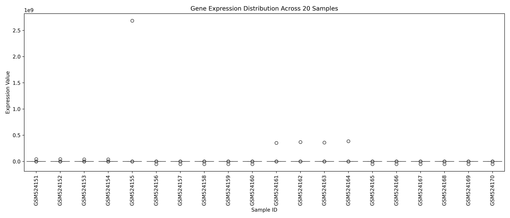
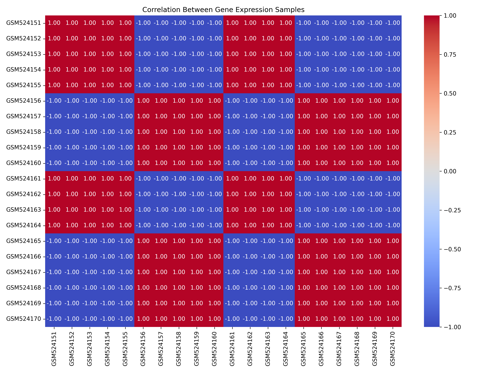

# Gene Expression Data Cleaning and Analysis

## Project Overview
This project focuses on cleaning, quality assessment, statistical analysis, and visualization of a publicly available human gene expression dataset from the NCBI Gene Expression Omnibus (GEO).

The analysis compares beta-cell-enriched tissue samples from non-diabetic controls and individuals with Type 2 Diabetes.

## Dataset Information

- **Dataset:** GSE20966
- **Organism:** *Homo sapiens*
- **Platform:** GPL1352 – Affymetrix Human X3P Array
- **Total samples:** 20
- **Control samples:** 10
- **Type 2 Diabetes samples:** 10
- **Probe identifiers:** 61,295
- **Data format:** Processed Series Matrix

**Dataset source:** [NCBI GEO – GSE20966](https://www.ncbi.nlm.nih.gov/geo/query/acc.cgi?acc=GSE20966)

## Tools and Technologies

- Python
- Google Colab
- Pandas
- NumPy
- Matplotlib
- Seaborn

## Methodology

1. Downloaded the processed gene expression dataset from NCBI GEO.
2. Imported the dataset into Google Colab using Pandas.
3. Examined the dataset dimensions and data types.
4. Checked for missing values and duplicate probe identifiers.
5. Calculated mean, median, and standard deviation for each sample.
6. Compared average expression signals between control and diabetes groups.
7. Generated a boxplot to examine sample expression distributions.
8. Generated a correlation heatmap to examine relationships between samples.
9. Exported the cleaned data, statistical summaries, and visualizations.

## Quality Assessment Results

- Total samples: 20
- Total probe identifiers: 61,295
- Missing values detected: 0
- Duplicate probe identifiers detected: 0
- All 20 sample columns contained numeric values.

No rows or samples were removed based on missing-value or duplicate-identifier checks.

## Visualizations

### Expression Distribution Across Samples



### Sample Correlation Heatmap



## Results

The analysis generated:
- Sample-wise statistical summaries.
- Average expression signal comparisons between control and diabetes groups.
- Expression distribution visualization.
- Sample correlation heatmap.
- A cleaned expression matrix for further analysis.

The group comparisons are descriptive and do not establish statistically significant differential expression.

## Repository Structure

```text
SWYNEX-Gene-Expression-Data-Analysis/
│
├── README.md
├── GSE20966_Gene_Expression_Analysis.ipynb
│
└── results/
    ├── cleaned_gene_expression.csv
    ├── sample_statistics.csv
    ├── control_vs_diabetes.csv
    ├── expression_boxplot.png
    └── correlation_heatmap.png
```

## Conclusion

This project demonstrates a basic bioinformatics workflow for processing and exploring gene expression data using Python. It provides an initial quality assessment and descriptive comparison of control and Type 2 Diabetes samples.

## Acknowledgement

Dataset obtained from the National Center for Biotechnology Information (NCBI), Gene Expression Omnibus (GEO).
